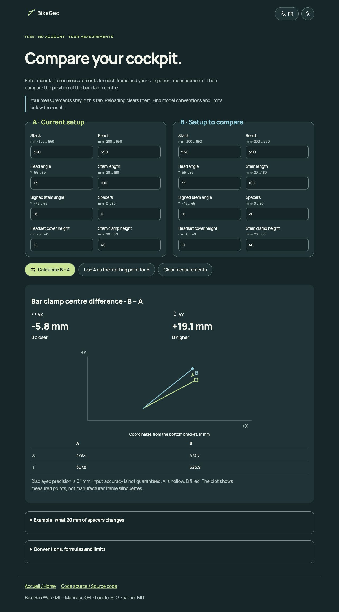

# BikeGeo Web

[Démo publique / Live demo](https://bikegeo.altorru.fr/compare/?from=github-readme) · [English demo](https://bikegeo.altorru.fr/compare/?lang=en&from=github-readme)

## Un exemple en deux minutes / A two-minute example

Données **fictives**, sans vélo constructeur ni recommandation de montage. / **Fictional** inputs, no manufacturer bike or assembly recommendation.

1. Ouvrir la démo, saisir A avec les valeurs ci-dessous, puis « Utiliser A comme base de B ». / Open the demo, enter A below, then “Use A as the starting point for B”.
2. Mettre uniquement les spacers de B à **20 mm**, puis calculer B − A. / Change only B spacers to **20 mm**, then calculate B − A.
3. Résultat attendu : **ΔX −5,8 mm ; ΔY +19,1 mm** — le centre du cintre recule et monte. / Expected: **ΔX −5.8 mm; ΔY +19.1 mm** — the clamp centre moves back and up.

| Mesure / Measurement | A |
|---|---:|
| Stack | 560 mm |
| Reach | 390 mm |
| Direction / Head angle | 73° |
| Potence / Stem length | 100 mm |
| Angle potence signé / Signed stem angle | −6° |
| Spacers | 0 mm |
| Capot / Headset cover | 10 mm |
| Collier / Stem clamp height | 40 mm |

L’exemple n’est pas prérempli et ne valide pas les limites fabricant. Les liens de démo portent seulement la provenance fixe `from=github-readme` : pas de mesure, identifiant, cookie ou nouvel outil analytique. Les logs existants peuvent compter des requêtes, pas des personnes ni des calculs terminés.

The example does not prefill the form or establish manufacturer limits. Demo links carry only the fixed `from=github-readme` source: no measurements, identifier, cookie or new analytics service. Existing host logs may count requests, not people or completed comparisons.

## Français

Comparateur gratuit de deux montages vélo : stack, reach, direction, potence, spacers, capot et collier. Résultat horizontal/vertical au **centre du cintre**, avec Δ = B − A. Saisie vide, copie A→B, effacement, FR/EN et thèmes clair/sombre. Aucune base de vélos ni géométrie constructeur inventée.

Les mesures restent dans la mémoire de l’onglet ; recharger ou fermer les efface. Aucun compte, cookie, appel d’envoi, tracker distant ou stockage navigateur. Un hébergeur reçoit les requêtes web et peut conserver des logs selon sa configuration. Publier les mesures dans une issue GitHub les rend publiques : utilisez des valeurs fictives.

La démo hébergée propose aussi des liens vers RideCalc ; cette édition source autonome contient le comparateur gratuit uniquement. Le déploiement de la démo reste distinct de ce dépôt. Aucun code Android, APK/AAB, signature, achat, licence Pro ou source interne. Aucun pilote humain ou revenu prétendu. Un calcul correct ne valide pas un montage sûr, une taille ou le confort : respectez les limites fabricant.

## English

Free comparison of two bicycle setups: stack, reach, head angle, stem, spacers, headset cover and clamp height. Horizontal/vertical **bar clamp centre** difference, Δ = B − A. Empty inputs, A→B copy, clear, FR/EN and light/dark themes. No bicycle catalogue or invented manufacturer geometry.

Measurements stay in tab memory and disappear on reload/close. No accounts, cookies, submission calls, remote trackers or browser storage. Hosting receives web requests and may retain logs under its own configuration. Use fictional data in public GitHub issues.

The hosted demo also links to RideCalc; this standalone source edition contains only the free comparator. Hosted deployment is separate. No Android source or binaries, signing, purchases, Pro or internal project files. No human-pilot or revenue claim. Calculations do not establish assembly safety, size or comfort; manufacturer limits prevail.

## Run locally / Lancer localement

Python 3 for serving; Node.js 22+ for tests. No dependency installation or build step.

```sh
git clone https://github.com/Altorru/bikegeo-web.git
cd bikegeo-web
python3 -m http.server 4214 --bind 127.0.0.1 --directory public
```

Open / ouvrir [http://127.0.0.1:4214/compare/](http://127.0.0.1:4214/compare/). Serve the files over HTTP; ES modules are not intended for file:// opening.

```sh
node tests/geometry.test.mjs
python3 scripts/check-static.py
```

Tests use independent analytical fixtures, spacer vectors, identical setups, translation/reversal, decimal parsing, invalid inputs and boundary finiteness. They are fictional tests, not cyclist feedback.

## Hosting / Hébergement

Serve `public/` as the document root on a static host. No backend, environment variables, payment setup or secrets required. If JavaScript is cached long-term, update the `app.js?v=…` content hash in the comparator HTML after changing the module. Adapt canonical/social URLs to your own domain when publishing a fork. Use HTTPS for a public host.

## Documentation & licences

- [Geometry and limits](docs/GEOMETRY.md)
- [Icon choices and third-party licences](THIRD_PARTY.md)
- [Contributing](CONTRIBUTING.md) · [Security reports](SECURITY.md)
- Original web code, docs and BikeGeo assets: [MIT](LICENSE).
- Manrope: SIL OFL 1.1. Lucide: ISC, with preserved Feather MIT notices. Those components retain their own licences.


